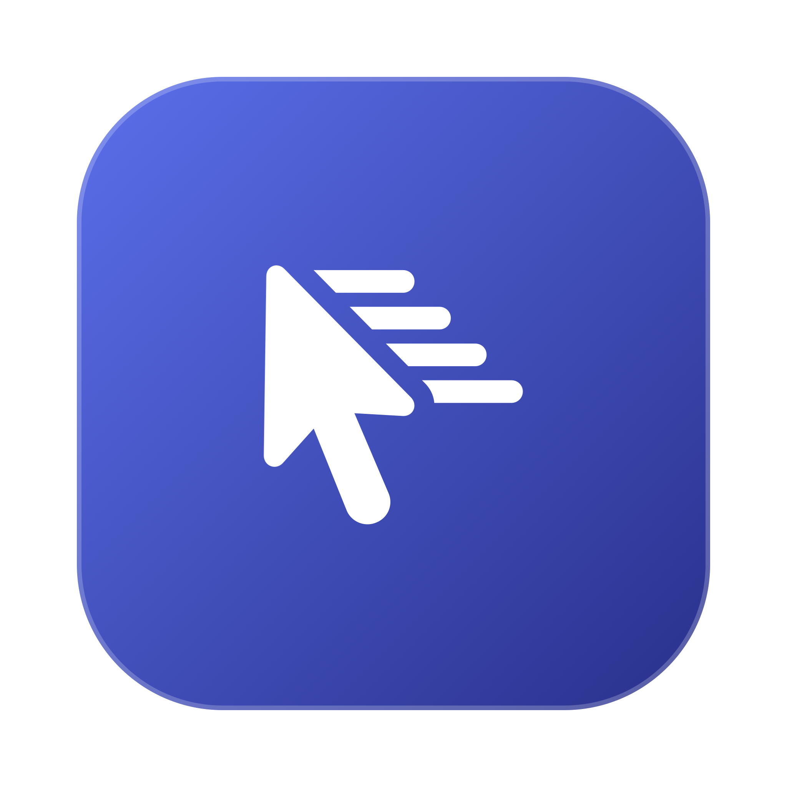

<div align="center">
  

# No Drag Release Delay

**A tap-drag ends the instant the last finger lifts.**

No delayed drop · no stray click · no Xcode required

[](LICENSE)
[](https://github.com/AmirAliManzar/no-drag-release-delay/releases/latest)
[](#requirements)
[](#requirements)

</div>

A tiny menu bar utility that ends a **tap-drag** the instant the last finger leaves the
trackpad, instead of the few hundred milliseconds later that macOS takes.

If you double-tap and hold to drag on a Mac trackpad — the way you would on Windows —
you already know the symptom: you let go, and the window keeps following the cursor for a
beat before it finally drops. This removes that beat.

---

## The problem

macOS implements tap-to-drag as a small state machine inside the trackpad driver:

1. The second tap of a double-tap starts a drag and the driver holds the left button down.
2. When your finger lifts, the driver **does not release the button immediately**. It keeps
   it pressed for a grace period so that a second touch can pick the drag back up — the
   same idea as drag lock, but automatic and invisible.
3. Only after that grace period expires does the real `leftMouseUp` reach the application.

That grace period is the delay. It is not exposed as a preference: `defaults read
com.apple.AppleMultitouchTrackpad` has `Dragging`, `DragLock`, and `TrackpadThreeFingerDrag`,
but nothing that shortens the release timeout.

Because the hold happens below the window server, an application cannot see it. What an
application *can* do is post its own `leftMouseUp` as soon as it knows the drag is over —
and the only reliable signal for "the drag is over" is "no finger is touching the
trackpad any more".

## How it works

```
MultitouchSupport.framework ──► contact frames ──► Engine ──► CGEvent(leftMouseUp)
        (private, dlopen'd)      (fingers per frame)   │              │
                                                      │              ▼
CGEvent tap (session, head insert) ◄──────────────────┘        HID event tap
        │  sees the release we posted (tagged) and the
        │  duplicate the system still has queued
        └─ swallows the duplicate
```

`Engine` is a deliberately conservative state machine. It posts a synthetic release only
when **all** of the following hold:

| Check | Why |
| --- | --- |
| Every contact is gone | Scrolling, two-finger gestures, and resting palms are never interrupted. |
| The check is repeated after a 35 ms settle window | A tap-to-click and a physical click both release the button within a frame or two of the lift; only a tap-drag keeps it pressed. |
| The left button is still down at that point | A synthetic mouse-up that does not belong to a drag is indistinguishable from a stray click. |
| Drag lock is off | Holding the button is the entire point of that setting. |
| The lift was not followed by a new touch | Re-grabbing the drag within the settle window cancels the release, so drag continuation still works. |

The synthetic event is stamped with `eventSourceUserData = 'NDRD'` so the event tap can
recognise its own work. After posting, the engine arms a one-second, 24-point window in
which it drops the duplicate `leftMouseUp` the system was going to deliver anyway —
otherwise that orphan release lands on whatever is under the cursor and reads as a click.

Latency added by the app: **35 ms**, in exchange for removing roughly 300 ms.

## Requirements

- macOS 13 Ventura or later.
- **Accessibility** permission. The app both reads an event tap and posts an event, and
  macOS gates both behind the same grant.
- Trackpad dragging enabled: *System Settings → Accessibility → Pointer Control →
  Trackpad Options → Use trackpad for dragging*.

Works with tap-to-drag and with three-finger drag. Does nothing while **drag lock** is on.

## Install

Download the artifact for your Mac from the [releases page][releases]:

| Artifact | Machine |
| --- | --- |
| `NoDragReleaseDelay-<version>-arm64.pkg` | Apple Silicon (M1 and later) — smoothest install |
| `NoDragReleaseDelay-<version>-x86_64.pkg` | Intel — smoothest install |
| `NoDragReleaseDelay-<version>-arm64.dmg` | Apple Silicon, drag to *Applications* |
| `NoDragReleaseDelay-<version>-x86_64.dmg` | Intel, drag to *Applications* |
| `NoDragReleaseDelay-<version>-arm64.app.zip` | Apple Silicon, unzipped app |
| `NoDragReleaseDelay-<version>-x86_64.app.zip` | Intel, unzipped app |

Prefer the `.pkg`: the installer launches the app itself, and files it installs carry no
quarantine flag, so there is no *Open Anyway* step. A `.dmg` or `.app.zip` downloaded with
a browser keeps macOS's quarantine mark, and its first launch needs **Open Anyway** once.

The artifacts are per-architecture on purpose: a universal binary carries an Intel slice
that macOS flags with an *App Update Required* warning on Apple Silicon, and the two
builds are otherwise identical.

The installers copy the app to `/Applications` and launch it, so the first-run window can
walk you through the accessibility grant. `SHA256SUMS` is published alongside them.

The build is signed with a stable self-signed certificate, not notarised. On first launch
macOS may say the app was downloaded from the internet; open *System Settings → Privacy &
Security* and choose **Open Anyway**, or run:

```sh
xattr -dr com.apple.quarantine "/Applications/No Drag Release Delay.app"
```

[releases]: https://github.com/AmirAliManzar/no-drag-release-delay/releases

## First run

1. **Accessibility access** — click *Grant*, then enable *No Drag Release Delay* in the
   list and confirm the system dialog if one appears. The app polls for the grant and
   starts the event tap on its own.
2. **Tap to drag** — turn it on if the row is not green.
3. **Try it** — double-tap the card in the window and drag it. It should stop the moment
   you lift your finger.

The menu bar shows the app icon's cursor mark. If it looks dimmed, step 1 is incomplete —
it reaches full strength once the engine is running.

## Updates

The app checks GitHub releases shortly after launch and every six hours, downloads the
package for its architecture and applies it through `installer` — you type your password
once, the app relaunches, done. The Accessibility grant survives because the signing
identity doesn't change between releases. Control it all from *Setup → Options → Update
automatically* and *Check now*, or from the status menu's *Check for Updates…* row. The
self-updater only runs for apps installed in /Applications; anywhere else a check simply
opens the [releases page][releases].

## Menu

| Item | |
| --- | --- |
| Enabled | Pause the engine without quitting. |
| Menu Bar | Always, while a window is open, or never — independent of the Dock; hide both and the engine keeps working in the background. |
| Show in Dock | Switches the activation policy between accessory and regular. |
| Check for Updates… | Runs the self-updater; its title tracks the whole update state. |
| Launch at Login | Registered through `SMAppService`. |
| Setup & Test… | The first-run window. |
| Open Diagnostics Log | `~/Library/Logs/NoDragReleaseDelay.log`. |

## Build from source

Requires the Xcode Command Line Tools (no Xcode project, no third-party dependencies):

```sh
git clone https://github.com/AmirAliManzar/no-drag-release-delay.git
cd no-drag-release-delay
./scripts/build.sh                 # universal
./scripts/build.sh arm64           # Apple Silicon only
./scripts/build.sh x86_64          # Intel only
```

Output lands in `build/<arch>/No Drag Release Delay.app`. Add `--install` to copy it to
`/Applications`.

Release artifacts — per-architecture `.pkg` installers and `.dmg` images, plus checksums:

```sh
./scripts/package.sh
```

### Distribution

`build.sh` signs ad-hoc, which is enough for local use but means every rebuild gets a new
`cdhash` and macOS asks for accessibility again. For a public build, sign with a Developer
ID and notarise:

```sh
export CODESIGN_IDENTITY="Developer ID Application: Your Name (TEAMID)"
codesign --force --options runtime --timestamp --sign "$CODESIGN_IDENTITY" "build/universal/No Drag Release Delay.app"
ditto -c -k --keepParent "build/universal/No Drag Release Delay.app" build/universal.zip
xcrun notarytool submit build/universal.zip --keychain-profile notary --wait
xcrun stapler staple "build/universal/No Drag Release Delay.app"
```

## Architecture

```
Sources/
  App/
    main.swift          NSApplication bootstrap
    AppDelegate.swift   status item, menu, permission polling
    StatusIcon.swift    the menu bar mark
    AppState.swift      single observable source of truth for the UI
    WindowManager.swift window ownership and reuse
    Installer.swift     "move to /Applications" for DMG launches
    MainMenu.swift      main menu, only while the Dock icon is visible
  Core/
    Engine.swift        contact state machine, event tap, duplicate suppression
    Multitouch.swift    dlopen bridge to MultitouchSupport.framework
    TrackpadSettings.swift  read-only view of the trackpad preference domains
    Preferences.swift   UserDefaults-backed settings
    Log.swift           serialised, rotating diagnostic log
    Author.swift        author metadata and links
  UI/
    MainView.swift      setup, options, drag test
    AboutView.swift     about panel
Resources/
  BrandIcons/           the vector marks used by the About panel
```

Notes on a few decisions:

- **No Xcode project.** `scripts/build.sh` calls `swiftc` directly, compiles both slices,
  and `lipo`s them. Fewer moving parts and a reproducible build on a machine that only has
  the Command Line Tools.
- **No SwiftUI state macros.** `@State` expands to a compiler plugin that ships with Xcode,
  not with the Command Line Tools, so the views use `ObservableObject` instead.
- **Private framework by `dlopen`.** `MultitouchSupport.framework` is private; loading it
  lazily means the app degrades to "unavailable" instead of failing to launch.
- **Devices are identified by `MTDeviceGetDeviceID`.** `MTDeviceCreateList` returns fresh
  device objects on every call, so pointer identity cannot be used to deduplicate.

## Troubleshooting

The diagnostic log is the first place to look:

```sh
tail -f ~/Library/Logs/NoDragReleaseDelay.log
```

| Symptom | Cause |
| --- | --- |
| The menu bar mark is dimmed | Accessibility not granted, or the grant was invalidated by a rebuild. |
| `not a drag, left alone` | The button was already up 35 ms after the lift — a click, not a drag. |
| `drag lock is on, leaving the button pressed` | Turn drag lock off. |
| Nothing logged at all | `multitouch: framework unavailable` — the private framework is missing on this OS. |
| Clicks occasionally dropped | Report it with the log; the duplicate-suppression window is the suspect. |

## Privacy

No network access, no analytics, no update check. The only file the app writes is its own
log in `~/Library/Logs`, which never contains keystrokes, window titles, or clipboard
contents — only contact counts and timings.

## License

[MIT](LICENSE) © 2026 Amir Ali Manzar.

---

## فارسی

این برنامه تأخیر آزاد شدن **درگ دو-تپی** روی ترک‌پد مک را حذف می‌کند. وقتی با دو تپ و
نگه‌داشتن چیزی را می‌کشید، مک دکمهٔ موس را چند صد میلی‌ثانیه بعد از برداشتن انگشت رها
می‌کند؛ این ابزار همان لحظهٔ برداشتن انگشت رها می‌کند.

- نیازمند دسترسی **Accessibility** است.
- *System Settings → Accessibility → Pointer Control → Trackpad Options* باید
  «Use trackpad for dragging» روشن باشد.
- اگر **Drag Lock** روشن باشد، برنامه عمداً کاری نمی‌کند.
- ساخت: `./scripts/build.sh` — نصب: `./scripts/build.sh --install`
